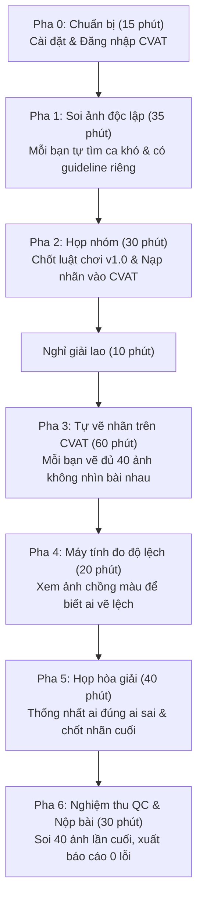

# Kế Hoạch Thực Hiện Bài Lab Day 07 — Dành Cho Dân Non-Tech (Nhóm Unicorn: 180 & 181)

> **Dành cho bạn:** Tài liệu này được viết bằng ngôn ngữ đời thường, giải thích rõ ràng từng khái niệm và hướng dẫn thao tác từng bước (cầm tay chỉ việc), giúp hai bạn hoàn thành bài lab 4 giờ một cách nhẹ nhàng và đạt điểm tối đa (100 điểm).

---

## 1. "Từ Điển" Khái Niệm Dành Cho Dân Non-Tech

Trước khi bắt đầu, hãy đọc nhanh bảng này để hiểu các thuật ngữ hay gặp trong bài:

| Thuật ngữ trong lab | Giải thích dân dã đời thường |
|---|---|
| **Annotation (Gán nhãn)** | Dùng chuột kéo vẽ các khung hình chữ nhật (Bounding Box) ôm lấy chiếc xe hoặc người trên ảnh để dạy máy tính nhận diện. |
| **Guideline (Cẩm nang quy tắc)** | "Luật chơi" do nhóm viết ra quy định rõ: gặp người đi xe máy thì vẽ mấy hộp, gặp tượng đá có vẽ không, hàng cồng kềnh vẽ thế nào... để 2 người vẽ giống nhau. |
| **Taxonomy (Bảng phân loại)** | Danh sách tên các loại xe/người được phép gán (`car`, `truck`, `motorcycle`...) và các đặc tính đi kèm (bị che ít hay nhiều). |
| **CVAT (`http://localhost:8080`)** | Phần mềm mở trên trình duyệt web dùng để xem ảnh và kéo chuột vẽ các khung hộp chữ nhật. |
| **COCO 1.0 (File JSON)** | File văn bản chứa tọa độ các hộp bạn vừa vẽ trên CVAT. Xuất file này từ CVAT ra để nộp bài (ví dụ `180.json`, `181.json`). |
| **Gán mù đôi (Double-blind)** | Cả hai bạn cùng vẽ trên 40 bức ảnh giống nhau, nhưng **tuyệt đối không được nhìn bài nhau** trong lúc vẽ để kiểm tra xem "luật chơi" của nhóm viết ra có rõ ràng không. |
| **IAA (Độ đồng thuận)** | Máy tính chạy phép so sánh xem hai bạn vẽ có giống nhau không: vị trí hộp có đè khít lên nhau không ($\ge 85\%$) và có chọn cùng loại xe không ($\ge 95\%$). |
| **Calibration (Họp hòa giải)** | Sau khi máy tính chỉ ra những bức ảnh mà hai bạn vẽ lệch nhau, hai bạn ngồi lại bàn xem ca đó ai đúng ai sai, thống nhất quy tắc và sửa lại nhãn cho chuẩn. |
| **QC (Kiểm tra chất lượng)** | Bước duyệt nghiệm thu cuối cùng (giống như KCS kiểm tra hàng xuất xưởng) để quyết định xem bộ dữ liệu có đủ chuẩn bàn giao hay không. |
| **Release / Hold / Rework** | **Release:** Đạt chuẩn, duyệt bàn giao!<br>**Rework:** Còn nhiều lỗi ($> 2\%$ ảnh) $\rightarrow$ phải làm lại.<br>**Hold:** Tạm giữ lại vì thiếu bằng chứng hoặc quy tắc chưa rõ. |

---

## 2. Phân Vai Trong Nhóm 2 Người

- **Bạn 180 (Người điều phối — Coordinator):**
  - Mở cửa sổ dòng lệnh (PowerShell) để chạy các câu lệnh mẫu có sẵn: chia ảnh, đo độ đồng thuận, gộp nhãn.
  - Tự vẽ 40 ảnh của mình trên CVAT.
- **Bạn 181 (Trưởng nhóm QC — Reviewer):**
  - Tự vẽ 40 ảnh của mình trên CVAT.
  - Ở bước cuối cùng (Pha 6), mở ảnh lên soi kiểm tra độc lập và ký duyệt biên bản nghiệm thu QC.

---

## 3. Lộ Trình 7 Pha Cụ Thể (Cầm Tay Chỉ Việc)



---

### Pha 0: Chuẩn Bị & Đăng Nhập CVAT (15 phút | Mốc 0:15)
*Mục đích: Đảm bảo máy tính chạy được lệnh và mở được trang web vẽ nhãn.*

1. **Cài đặt thư viện (Bạn 180 mở PowerShell gõ lệnh):**
   ```powershell
   python -m pip install -r requirements.txt
   ```
   *(Đã xong! Máy tính đã sẵn sàng).*
2. **Thông tin nhóm:** File `TEAM.md` đã được điền sẵn tên nhóm Unicorn và mã `180, 181`.
3. **Mở CVAT:** Cả hai bạn mở trình duyệt web lên, đăng nhập vào tài khoản CVAT của lớp (hoặc bản local `http://localhost:8080`) và đảm bảo trang web hoạt động bình thường.

---

### Pha 1: Soi 40 Ảnh & Viết Guideline Riêng (35 phút | Mốc 0:50)
*Mục đích: Mỗi người tự xem 40 bức ảnh một mình để phát hiện các tình huống kỳ lạ mà luật ban đầu chưa nói tới.*

- **Thao tác:** Mở thư mục `data/images/` xem lướt từ `img_001.jpg` đến `img_040.jpg`.
- **Kết quả đã chuẩn bị sẵn trong repo:**
  - Bạn 180 đã có file: `submission/guidelines/individual/guideline_180.md` & `submission/individual_notes/180.md`.
  - Bạn 181 đã có file: `submission/guidelines/individual/guideline_181.md` & `submission/individual_notes/181.md`.
- **4 "cạm bẫy" lớn bạn cần chú ý khi nhìn ảnh:**
  1. **Người đi xe máy:** Phải vẽ 2 hộp riêng (1 hộp người + 1 hộp xe máy), KHÔNG vẽ 1 hộp to bao cả hai.
  2. **Xe tải chở ô tô (`img_002.jpg`):** Vẽ 1 hộp to cho xe tải + 8 hộp nhỏ cho 8 ô tô con trên sàn xe.
  3. **Hàng hóa cồng kềnh (`img_029.jpg`, `img_035.jpg`):** Tuk-tuk hoặc xe máy chở núi bao tải to đùng $\rightarrow$ CHỈ VẼ HỘP ÔM XE, KHÔNG VẼ TRÙM LÊN NÚI BAO TẢI.
  4. **Các vật vô tri:** Ma-nơ-canh (`img_033.jpg`), xe trong gương chiếu hậu (`img_020.jpg`), tượng đài xe bán tải bằng đá (`img_027.jpg`), tượng đồng (`img_017.jpg`), ảnh in quảng cáo (`img_018.jpg`), đồ chơi tủ kính (`img_038.jpg`) $\rightarrow$ **KHÔNG VẼ GÌ HẾT** (ảnh rỗng 0 hộp).

---

### Pha 2: Họp Nhóm Chốt Luật Chơi v1.0 & Nạp Nhãn Vào CVAT (30 phút | Mốc 1:20)
*Mục đích: Hai bạn thống nhất "luật chơi" chung để cả hai người cùng vẽ theo một kiểu.*

1. **Xem file luật chơi chung đã soạn sẵn:** `submission/guidelines/guideline_v1.0_agreed.md` (gồm 8 lớp và 10 quy tắc `R-01` đến `R-10`).
2. **Cập nhật danh sách nhãn vào CVAT:**
   - Lệnh sinh nhãn đã chạy xong và tạo ra file `cvat/labels_generated.json`.
   - **Thao tác trên CVAT:**
     - Bấm **Projects $\rightarrow$ Create new project**.
     - Đặt tên Project: `Unicorn-D07`.
     - Ở mục **Labels**, chọn tab **Raw**.
     - Mở file `cvat/labels_generated.json` trong máy, copy toàn bộ nội dung và dán vào ô Raw trên CVAT.
     - Bấm nút **Done** $\rightarrow$ bấm **Submit & Open**.
     - Lúc này Project trên CVAT của bạn đã có đủ 8 nhãn màu rực rỡ (`car`, `truck`, `van`, `bus`, `tuk_tuk`, `motorcycle`, `person`, `ignore_region`).

---

### (Nghỉ Giải Lao: 10 phút | Mốc 1:30)
*Hai bạn đứng dậy uống nước, thư giãn mắt trước khi vào pha vẽ nhãn.*

---

### Pha 3: Phân Công & Vẽ Nhãn Độc Lập Trên CVAT (60 phút | Mốc 2:30)
*Mục đích: Mỗi người tự tạo Task trên CVAT và vẽ đủ 40 ảnh mà không hỏi bài nhau.*

#### Bước 3.1: Chạy lệnh chia ảnh (Bạn 180 chạy 1 lần duy nhất)
Mở PowerShell gõ lệnh sau rồi bấm Enter:
```powershell
python scripts/split_assign.py --members 180,181 --copy-images
```
- Lệnh này tạo ra bảng phân công `submission/qc/assignment.csv` (ghi nhận cả 2 bạn đều làm đủ 40 ảnh).
- Đồng thời nó copy sẵn 40 ảnh vào thư mục `work/180/images/` và `work/181/images/`.

#### Bước 3.2: Tạo Task cá nhân trên CVAT
- **Bạn 180:** 
  - Vào Project `Unicorn-D07` $\rightarrow$ Bấm nút **+ Create a new task**.
  - Đặt tên Task: `task-180`.
  - Bấm chọn tải lên toàn bộ ảnh trong thư mục `work/180/images/` (đủ 40 ảnh).
  - Bấm **Submit & Open**.
- **Bạn 181:** 
  - Làm tương tự, đặt tên Task: `task-181`, tải toàn bộ ảnh trong `work/181/images/`.

#### Bước 3.3: Thao tác vẽ hộp trên CVAT (Bí kíp phím tắt nhanh)
- Bấm vào Job để mở giao diện vẽ ảnh.
- Bấm phím **`N`** (Rectangle) để bắt đầu vẽ:
  1. Kéo chuột chéo từ góc này sang góc kia để bao quanh vật.
  2. Ở bảng **Objects** bên phải:
     - Chọn đúng loại xe/người (`Label`).
     - Chọn `occluded_level`:
       - `0`: Nhìn thấy trọn vẹn 100%.
       - `1`: Bị che khuất một ít (1–30%).
       - `2`: Bị che khuất nhiều (31–70%).
       - `3`: Bị che gần hết (> 70%).
     - Chọn `truncated`: Chọn `yes` nếu xe/người bị cắt cụt ở mép viền ảnh, chọn `no` nếu nằm trọn vẹn trong ảnh.
     - Ô `can_review`: Nếu phân vân ca này khó quá, tick vào ô này để tí nữa họp hòa giải ở Pha 5.
- Bấm phím **`F`** để sang ảnh kế tiếp. Bấm **`D`** để lùi lại ảnh trước.
- **Bấm `Ctrl + S` thường xuyên để lưu bài!**
- **Lưu ý ảnh trống:** Các ảnh `img_017.jpg`, `img_020.jpg`, `img_027.jpg`, `img_033.jpg`, `img_038.jpg` không vẽ hộp nào cả, cứ để trống và bấm `F` sang ảnh tiếp theo.

#### Bước 3.4: Xuất file nhãn nộp bài
Khi vẽ xong cả 40 ảnh:
1. Quay lại trang chi tiết Task trên CVAT.
2. Bấm nút **Actions $\rightarrow$ Export task dataset**.
3. Chọn định dạng: **COCO 1.0**.
4. **BỎ TÍCH ô "Save images"** (chỉ lấy nhãn, không lấy lại ảnh).
5. Bấm **OK**. CVAT sẽ chuyển sang tab **Requests**, đợi chạy 100% thì bấm nút tải file `.zip` về máy.
6. Mở file `.zip`, tìm file `annotations/instances_default.json`:
   - Bạn 180 đổi tên file đó thành: `180.json` rồi thả vào thư mục `submission/labels/`.
   - Bạn 181 đổi tên file đó thành: `181.json` rồi thả vào thư mục `submission/labels/`.
7. Kiểm tra tính hợp lệ bằng lệnh:
   ```powershell
   python scripts/validate_labels.py submission/labels/180.json
   python scripts/validate_labels.py submission/labels/181.json
   ```
   *(Nếu terminal báo "hợp lệ về cấu trúc, 40 ảnh" là bạn đã thành công 100%)*.

---

### Pha 4: Máy Tính Đo Độ Lệch & Xem Ảnh Chồng Màu (20 phút | Mốc 2:50)
*Mục đích: Dùng script tự động để phát hiện xem hai bạn vẽ lệch nhau ở những bức ảnh nào.*

1. **Chạy lệnh đo tự động:**
   ```powershell
   python scripts/validate_labels.py --all
   python scripts/qc_compare.py
   ```
   - Terminal sẽ in ra kết quả: IoU trung bình (mục tiêu $\ge 0.85$) và % cùng lớp (mục tiêu $\ge 95\%$).
   - Script tự động tìm ra các ca bất đồng và tạo ra file `submission/qc/calibration_candidates.csv`.
2. **Vẽ ảnh so sánh chồng màu (Bạn 180 gõ lệnh):**
   ```powershell
   python scripts/viz_disagreement.py --images flagged
   ```
3. **Xem kết quả:**
   - Mở thư mục `work/viz/`: Bạn sẽ thấy ảnh có vẽ đè các hộp màu của bạn 180 và bạn 181 lên nhau.
   - Bạn sẽ nhìn thấy ngay: Chỗ nào một bạn vẽ mà bạn kia quên, chỗ nào một bạn vẽ hộp quá rộng, hoặc một bạn chọn nhầm loại xe.

---

### Pha 5: Họp Hòa Giải (Calibration) & Tạo Bộ Nhãn Cuối (40 phút | Mốc 3:30)
*Mục đích: Hai bạn ngồi lại với nhau, chốt xem ca bất đồng nào theo ý ai, sửa nhãn lại cho chuẩn và đóng dấu bàn giao.*

1. **Khởi tạo bảng quyết định (Bạn 180 gõ lệnh):**
   ```powershell
   python scripts/build_final.py
   ```
   *(Lệnh này sinh ra bảng mẫu `submission/qc/calibration_decisions.csv` có 9 cột)*.
2. **Điền bảng quyết định:**
   - Mở file `submission/qc/calibration_decisions.csv` bằng Excel hoặc Notepad.
   - Với mỗi dòng ảnh bị lệch: ghi rõ quyết định thống nhất của nhóm, điền mã quy tắc (ví dụ `R-03`, `R-04`), người chốt (`180` hoặc `181`) và người kiểm lại.
3. **Chuẩn bị dữ liệu sửa:**
   - Tạo file `submission/guideline_change.json` với nội dung tóm tắt thay đổi (ví dụ: `{"kind": "semantic", "summary": "Chốt quy tắc tuk-tuk không bao khối hàng rời"}`).
   - Gõ lệnh:
     ```powershell
     python scripts/prepare_calibration.py
     ```
   - Lệnh sẽ in ra màn hình một đường dẫn file có chuỗi mã băm bảo mật (ví dụ: `submission\qc\labels_calibrated_abc123456.json`). Hãy copy lại tên đường dẫn này!
4. **Sửa nhãn trên CVAT:**
   - Tạo 1 Task mới trên CVAT từ ảnh trong `work/calib/images/`.
   - Bấm **Actions $\rightarrow$ Upload annotations $\rightarrow$ COCO 1.0**, chọn file `work/calib/consensus_flagged.json` nạp lên.
   - Mở ra sửa lại vài hộp bị lệch theo đúng quyết định của hai bạn, tắt hết ô `can_review`.
   - Xuất lại COCO 1.0 (tắt Save images), lưu đúng vào tên file có mã băm mà script vừa in ở Bước 3.
5. **Gộp tạo bộ nhãn cuối:**
   ```powershell
   python scripts/build_final.py
   ```
   *(Script sẽ gộp và tạo ra `labels_calibrated.json` hoàn chỉnh).*

---

### Pha 6: Nghiệm Thu QC Toàn Lô & Nộp Bài (30 phút | Mốc 4:00)
*Mục đích: Bạn 181 đóng vai Reviewer soi lại 40 ảnh thành phẩm, kiểm tra lần cuối để đảm bảo đạt 100 điểm.*

1. **Xuất ảnh nghiệm thu:**
   ```powershell
   python scripts/qc_sample.py --round 1
   ```
   *(Máy tính sẽ tự động xuất 40 bức ảnh có đánh số thứ tự từng vật thể `#1 car`, `#2 person`... vào thư mục `work/review/round-01/`)*.
2. **Điền phiếu nghiệm thu:**
   - Mở 40 ảnh trong `work/review/round-01/` lên xem.
   - Mở file `submission/qc/reviews/round-01/qc_review.csv`:
     - Nếu ảnh chuẩn đẹp không có lỗi gì: ghi 1 dòng gồm tên ảnh, `error_type = khong`, `reviewer = 181`.
     - Nếu phát hiện lỗi: ghi ID vật bị lỗi và loại lỗi (`sai_lop`, `thua`, `bo_sot`...).
3. **Chạy báo cáo tổng hợp:**
   ```powershell
   python scripts/qc_report.py --round 1
   ```
   *(Nếu tỉ lệ ảnh lỗi $\le 2\%$, tức 0/40 ảnh lỗi, máy sẽ báo: **`RELEASE`** — Chúc mừng bạn đã đạt chuẩn xuất sắc!)*.
4. **Hoàn thiện biên bản:**
   - Điền đầy đủ thông tin vào `submission/qc/QC_REPORT.md` (xóa sạch các chữ mẫu `<<...>>`).
   - Cả 2 bạn điền vài dòng cảm nghĩ vào `individual_notes/180.md` và `181.md`.
5. **Nghiệm thu kỹ thuật cuối cùng:**
   ```powershell
   python scripts/check_submission.py --round 1
   ```
   *(Phải hiện dòng chữ: **`Tổng kết: 0 lỗi`**)*.

---

## 4. Bảng Lệnh "Copy & Paste" Tổng Hợp

Khi làm việc, bạn chỉ cần mở PowerShell và copy lần lượt các câu lệnh sau:

| Bước | Câu lệnh cần copy & paste | Giải thích ngắn |
|---|---|---|
| **1** | `python scripts/make_cvat_labels.py` | Tạo bộ nhãn để dán vào CVAT |
| **2** | `python scripts/split_assign.py --members 180,181 --copy-images` | Chia 40 ảnh cho 180 và 181 |
| **3** | `python scripts/validate_labels.py submission/labels/180.json` | Kiểm tra file nhãn của bạn 180 |
| **4** | `python scripts/validate_labels.py submission/labels/181.json` | Kiểm tra file nhãn của bạn 181 |
| **5** | `python scripts/qc_compare.py` | Đo độ đồng thuận giữa 2 người |
| **6** | `python scripts/viz_disagreement.py --images flagged` | Vẽ ảnh chồng màu để xem chỗ lệch |
| **7** | `python scripts/build_final.py` | Lần 1: Tạo bảng quyết định hòa giải |
| **8** | `python scripts/prepare_calibration.py` | Chuẩn bị dữ liệu và lấy tên file hash |
| **9** | `python scripts/build_final.py` | Lần 2: Tạo bộ nhãn chuẩn cuối cùng |
| **10** | `python scripts/qc_sample.py --round 1` | Xuất 40 ảnh để Reviewer soi nghiệm thu |
| **11** | `python scripts/qc_report.py --round 1` | Chạy báo cáo nghiệm thu QC |
| **12** | `python scripts/check_submission.py --round 1` | Kiểm tra gói nộp (phải đạt 0 lỗi) |

---

## 5. Lưu Ý "Sống Còn" Khi Nộp Bài
1. **Không nộp thư mục `work/`:** Thư mục `work/` chỉ dùng tạm trên máy tính của bạn, không đưa vào Git commit.
2. **Không dùng tên thật hay email:** Mọi file đều dùng mã số `180` và `181`.
3. **Giữ nguyên mục `rules` trong `taxonomy.json`:** Tuyệt đối không chỉnh sửa các con số ngưỡng kỹ thuật trong mục `rules`.
